  

<h3 align="center"><samp>idkroh@github:~ $ ./contributions.sh</samp></h3>

  

<h3 align="center"><samp>idkroh@github:~ $ whoami</samp></h3>

<table>
  <tr>
    <td width="36%" align="center" valign="middle">
      
       
      <samp><strong>Rohith Ramesh</strong> @idkroh</samp>
    </td>
    <td width="64%" valign="middle">
      
    </td>
  </tr>
</table>

I build web applications and AI tools, from payment intelligence and computer vision to developer workflows. I work with **TypeScript, React, and Python**, with an eye for interfaces that feel as good as they work.

<h3 align="center"><samp>idkroh@github:~ $ cat stack.json</samp></h3>

  

<h3 align="center"><samp>idkroh@github:~ $ ls projects/</samp></h3>

<table>
  <tr>
    <td width="50%"></td>
    <td width="50%"></td>
  </tr>
  <tr>
    <td width="50%"></td>
    <td width="50%"></td>
  </tr>
</table>

  <a href="https://github.com/idkroh?tab=repositories"><samp>Browse my repositories ↗</samp></a>
  &nbsp;·&nbsp;
  <a href="https://github.com/idkroh/idkroh/issues"><samp>Say hello ↗</samp></a>

